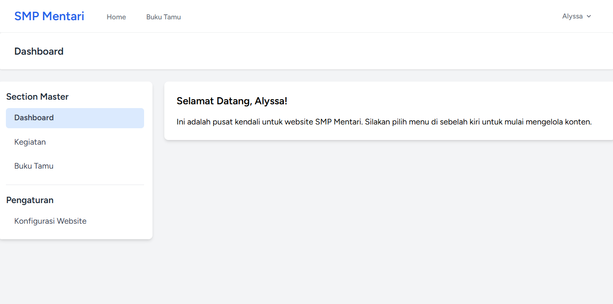
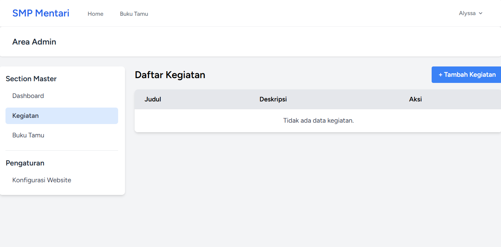

# 📘 Laporan Praktikum Pertemuan Ke - 5

🧑‍🎓 Maria Natalia Alyssa Beli - 4524210133

# 🏫 Website SMP Mentari Ceria

Aplikasi website sekolah berbasis Laravel yang menampilkan informasi kegiatan sekolah dan fitur buku tamu digital untuk SMP Mentari Ceria.

<p align="center">
  
  
  
</p>

## Instalasi

### 1. Clone Repository

```bash
git clone https://github.com/adiwp/pbw.git
cd smpmentari
```

### 2. Install Dependencies

```bash
# Install PHP dependencies
composer install

# Install Node dependencies
npm install
```

### 3. Setup Environment

```bash
# Copy file .env
cp .env.example .env

# Generate application key
php artisan key:generate
```

### 4. Setup Database

```bash
# Jalankan migrasi
php artisan migrate
```

### 5. Build Assets

```bash
# Development
npm run dev

# Production
npm run build
```

### 6. Jalankan Aplikasi

```bash
# Menggunakan built-in server
php artisan serve

# Atau menggunakan composer script (recommended)
composer dev
```

Aplikasi akan berjalan di: `http://localhost:8000`

## 📋 Daftar Isi

- [Tentang Aplikasi](#-tentang-aplikasi)
- [Fitur Utama](#-fitur-utama)
- [Tech Stack](#-tech-stack)
- [Persyaratan Sistem](#-persyaratan-sistem)
- [Instalasi](#-instalasi)
- [Penggunaan](#-penggunaan)
- [Struktur Database](#-struktur-database)
- [Struktur Project](#-struktur-project)
- [Pengembangan](#-pengembangan)
- [Testing](#-testing)
- [Lisensi](#-lisensi)

## 🎯 Tentang Aplikasi

Website SMP Mentari Ceria adalah aplikasi web sederhana yang dibangun dengan Laravel 12 untuk menampilkan informasi dan kegiatan sekolah. Aplikasi ini dilengkapi dengan fitur buku tamu digital yang memungkinkan pengunjung meninggalkan pesan dan kesan mereka.

### Fitur Halaman:

1. **Halaman Home** - Menampilkan kegiatan-kegiatan terbaru sekolah
2. **Buku Tamu** - Formulir interaktif untuk pengunjung meninggalkan pesan

## ✨ Fitur Utama

- ✅ **Tampilan Kegiatan Sekolah** - Showcase kegiatan terbaru dengan card design
- ✅ **Buku Tamu Digital** - Pengunjung dapat meninggalkan pesan
- ✅ **Form Validasi** - Validasi input untuk nama, email, dan pesan
- ✅ **Real-time Feedback** - Notifikasi sukses/error setelah submit
- ✅ **Responsive Design** - Tampilan optimal di semua device
- ✅ **Timestamp Relatif** - Menampilkan waktu pesan (e.g., "2 jam yang lalu")
- ✅ **Modern UI/UX** - Desain clean dengan Tailwind CSS

## 🛠️ Tech Stack

### Backend
- **Laravel** 12.x - PHP Framework
- **PHP** ^8.2 - Programming Language
- **SQLite** - Database (Development)
- **Eloquent ORM** - Database Management

### Frontend
- **Blade Templates** - Template Engine
- **Tailwind CSS** 4.0 - CSS Framework
- **Vite** 7.0 - Asset Bundler & HMR
- **Axios** - HTTP Client

### Development Tools
- **Laravel Sail** - Docker Development Environment
- **Pest PHP** - Testing Framework
- **Laravel Pint** - Code Style Fixer
- **Concurrently** - Multi-command Runner

## 📸 Hasil Screenshot Tampilan Website SMP Mentari

### Halaman Home


### Halaman Buku Tamu


### Halaman Register


### Halaman Login


### Halaman Dashboard

Dashboard di akses ketika sudah login dan bisa mengatur atau pusat kendali dari website SMP Mentari



Kendali atau mengelola kegiatan SMP Mentari



Kelola Buku Tamu


Konfigurasi tampilan Home Kegiatan per page dengan default nya 6 (Bisa diubah sesuai keinginan)


<p align="center">
Made with ❤️ for SMP Mentari Ceria
</p>

---

# 📘 Laporan Praktikum Pemrograman Berbasis Web

🧑‍🎓 **Maria Natalia Alyssa Beli — 4524210133**

# 📚 Sistem Manajemen Buku dengan Laravel & Filament

Aplikasi web untuk mengelola data buku dan penulis menggunakan Laravel dan Filament 3.x. Aplikasi menyediakan panel admin untuk melakukan pengelolaan data, pencarian, filter, melihat detail buku, serta pengaturan akses pengguna.

<p align="center">
  
  
  
  
</p>

## 📋 Daftar Isi

- [Tentang Aplikasi](#-tentang-aplikasi)
- [Fitur Utama](#-fitur-utama)
- [Tech Stack](#-tech-stack)
- [Persyaratan Sistem](#-persyaratan-sistem)
- [Instalasi](#-instalasi)
- [Penggunaan](#-penggunaan)
- [Struktur Database](#-struktur-database)
- [Struktur Project](#-struktur-project)
- [Hasil Screenshot](#-hasil-screenshot)
- [Testing](#-testing)
- [Troubleshooting](#-troubleshooting)
- [Referensi](#-referensi)

## 🎯 Tentang Aplikasi

Sistem Manajemen Buku merupakan aplikasi yang dibuat dalam praktikum Pemrograman Berbasis Web menggunakan Laravel dan Filament 3.x. Aplikasi ini digunakan untuk membantu pengelolaan koleksi buku dan data penulis melalui admin panel.

Praktikum ini menerapkan konsep MVC pada Laravel, migration, model, relasi database, factory, seeder, CRUD, upload gambar, pencarian, filter, dan authorization menggunakan Policy.

### Halaman dan Bagian Aplikasi

1. **Admin Login** — halaman untuk masuk ke panel pengelolaan.
2. **Dashboard** — halaman utama admin panel dan tempat menampilkan ringkasan data.
3. **Books** — mengelola data buku, termasuk melihat detail, menambah, mengubah, mencari, memfilter, dan menghapus data sesuai hak akses.
4. **Authors** — mengelola data penulis dan melihat jumlah buku yang terkait.
5. **Book Details** — menampilkan informasi lengkap buku.

## ✨ Fitur Utama

- ✅ **CRUD Data Buku** — menambah, melihat, mengubah, dan menghapus data buku.
- ✅ **Manajemen Penulis** — mengelola data penulis buku.
- ✅ **Relasi Buku dan Penulis** — satu penulis dapat memiliki banyak buku.
- ✅ **Pencarian dan Filter** — mencari buku serta memfilter berdasarkan status, tahun, atau penulis.
- ✅ **Upload Cover Buku** — mengunggah gambar sampul buku.
- ✅ **Validasi Form** — memeriksa input pada formulir.
- ✅ **Factory dan Seeder** — membuat data contoh untuk pengujian.
- ✅ **Book Description** — menambahkan deskripsi pada data buku.
- ✅ **Role-Based Access** — membedakan hak akses admin, staff, dan viewer melalui Policy.
- ✅ **Dashboard Statistics** — menampilkan jumlah buku, jumlah penulis, serta perbandingan buku tersedia dan dipinjam.
- ✅ **Kategori Buku** — menghubungkan buku dengan kategori melalui relasi many-to-many.

> Catatan: fitur kustomisasi seperti deskripsi buku, role-based access, widget dashboard, dan kategori merupakan bagian dari Tugas 2 pada modul praktikum. Pastikan fitur yang belum selesai diimplementasikan disesuaikan kembali dengan kondisi project sebelum README dikumpulkan.

## 🛠️ Tech Stack

### Backend
- **Laravel** — framework aplikasi web berbasis PHP.
- **PHP** — bahasa pemrograman utama.
- **Eloquent ORM** — pengelolaan data dan relasi database.
- **SQLite / MySQL** — database, sesuai konfigurasi project.

### Admin Panel & Frontend
- **Filament 3.x** — pembuatan admin panel, form, tabel, action, dan widget.
- **Livewire** — komponen antarmuka interaktif.
- **Blade** — template bawaan Laravel.
- **Tailwind CSS** — styling antarmuka.

### Development Tools
- **Composer** — pengelola dependency PHP.
- **Node.js dan npm** — pengelolaan package frontend.
- **Vite** — build dan pengelolaan aset frontend.
- **Git** — version control.

## 💻 Persyaratan Sistem

Pastikan perangkat sudah memiliki:

- PHP yang sesuai dengan versi Laravel dan Filament pada project.
- Composer.
- Node.js dan npm.
- SQLite atau MySQL.
- Web browser.
- Text editor seperti Visual Studio Code.
- Ekstensi PHP yang dibutuhkan oleh dependency project, termasuk `intl` jika diminta oleh Composer.

Periksa instalasi melalui terminal:

```bash
php -v
composer -V
node -v
npm -v
php artisan --version
```

## 🚀 Instalasi

### 1. Masuk ke Direktori Project

Jika project sudah tersedia di komputer, buka terminal pada folder project `authbook`.

Contoh menggunakan PowerShell:

```powershell
cd C:\xampp\htdocs\4524210133-MariaNataliaAlyssaBeli-PBW-A\authbook
```

Sesuaikan lokasi folder dengan tempat project disimpan.

### 2. Install Dependencies

```bash
composer install
npm install
```

Jika Composer menampilkan pesan bahwa ekstensi PHP `intl` belum tersedia, aktifkan ekstensi tersebut pada konfigurasi PHP yang digunakan terminal, kemudian jalankan kembali `composer install`.

### 3. Konfigurasi Environment

Jika file `.env` belum tersedia, salin dari `.env.example`.

PowerShell:

```powershell
Copy-Item .env.example .env
```

Kemudian buat application key:

```bash
php artisan key:generate
```

### 4. Konfigurasi Database

Pilih konfigurasi database yang digunakan oleh project.

**Pilihan A — SQLite**

Atur bagian database pada file `.env`:

```env
DB_CONNECTION=sqlite
```

Pastikan file database tersedia di `database/database.sqlite`. Jika belum ada, buat file kosong melalui PowerShell:

```powershell
New-Item database/database.sqlite -ItemType File
```

**Pilihan B — MySQL (XAMPP)**

Buat database melalui phpMyAdmin, misalnya dengan nama `authbook`, lalu sesuaikan `.env`:

```env
DB_CONNECTION=mysql
DB_HOST=127.0.0.1
DB_PORT=3306
DB_DATABASE=authbook
DB_USERNAME=root
DB_PASSWORD=
```

Gunakan hanya salah satu konfigurasi database sesuai project. Setelah mengubah `.env`, bersihkan cache konfigurasi:

```bash
php artisan optimize:clear
```

### 5. Jalankan Migration

```bash
php artisan migrate
```

Jika ingin menghapus seluruh tabel dan membuat ulang database beserta data contoh, gunakan perintah berikut **hanya jika data lama boleh dihapus**:

```bash
php artisan migrate:fresh --seed
```

### 6. Siapkan Storage untuk Cover Buku

```bash
php artisan storage:link
```

### 7. Jalankan Aplikasi

Jalankan server Laravel:

```bash
php artisan serve
```

Pada terminal lain, jalankan aset frontend jika diperlukan:

```bash
npm run dev
```

Buka alamat berikut di browser:

- **Aplikasi:** `http://localhost:8000`
- **Admin Panel:** `http://localhost:8000/admin`

Jika panel meminta login, gunakan akun yang sudah dibuat melalui seeder atau perintah pembuatan user Filament.

## 🖥️ Penggunaan

### 1. Login Admin
Buka `http://localhost:8000/admin` dan masuk menggunakan akun yang sudah terdaftar.

### 2. Mengelola Buku
Pilih menu **Books** untuk melihat daftar buku. Gunakan tombol tambah untuk membuat data baru. Isi informasi buku, pilih penulis, tentukan status, dan unggah cover jika diperlukan.

### 3. Melihat Detail Buku
Pilih aksi **View** pada salah satu data buku untuk melihat informasi detailnya.

### 4. Mencari dan Memfilter Buku
Gunakan kolom pencarian untuk mencari judul atau informasi buku. Gunakan filter untuk menyaring data berdasarkan status, tahun, atau penulis.

### 5. Mengelola Penulis
Pilih menu **Authors** untuk menambah, mengubah, melihat, atau menghapus data penulis sesuai hak akses.

### 6. Hak Akses Pengguna
Jika fitur role-based access sudah diterapkan, hak akses yang direncanakan adalah:

| Role | Hak Akses |
|---|---|
| **Admin** | Semua akses terhadap data buku. |
| **Staff** | Melihat, menambah, dan mengubah buku, tetapi tidak menghapus. |
| **Viewer** | Hanya melihat daftar dan detail buku. |

## 🗃️ Struktur Database

Struktur utama database pada aplikasi:

| Tabel | Fungsi |
|---|---|
| `users` | Menyimpan akun pengguna admin panel dan role jika sudah ditambahkan. |
| `authors` | Menyimpan data penulis. |
| `books` | Menyimpan informasi buku, penulis, penerbit, tahun, cover, status, dan deskripsi jika sudah ditambahkan. |
| `categories` | Menyimpan kategori buku jika fitur kategori sudah dibuat. |
| `book_category` | Tabel penghubung untuk relasi many-to-many antara buku dan kategori jika sudah dibuat. |

### Relasi Antar Tabel

- **Author — Book (One-to-Many):** satu penulis dapat memiliki banyak buku, sedangkan satu buku memiliki satu penulis.
- **Book — Category (Many-to-Many):** satu buku dapat memiliki beberapa kategori dan satu kategori dapat digunakan oleh beberapa buku.

## 📁 Struktur Project

Bagian folder yang penting dalam pengembangan aplikasi:

```text
authbook/
├── app/
│   ├── Filament/
│   │   ├── Resources/
│   │   │   ├── AuthorResource.php
│   │   │   └── BookResource.php
│   │   └── Widgets/
│   ├── Models/
│   │   ├── Author.php
│   │   ├── Book.php
│   │   ├── Category.php
│   │   └── User.php
│   └── Policies/
│       └── BookPolicy.php
├── database/
│   ├── factories/
│   ├── migrations/
│   └── seeders/
├── resources/
├── routes/
├── storage/
├── .env
├── artisan
└── composer.json
```

> Struktur di atas merupakan gambaran bagian-bagian utama project. File seperti `Category.php`, widget, atau policy tambahan hanya ada jika sudah dibuat pada project.

## 📸 Hasil Screenshot

### Halaman Login Admin


### Dashboard


### Daftar Buku


### Form Create Book


### Hasil Pencarian


### Filter Aktif


### Daftar Penulis


### Widget Statistik dan Kategori Buku


## 🧪 Testing

Lakukan pengujian dasar berikut setelah aplikasi berjalan:

- [ ] Admin panel dapat dibuka dan login berhasil.
- [ ] Daftar buku dan daftar penulis dapat ditampilkan.
- [ ] Data buku dapat ditambahkan, dilihat, dan diubah.
- [ ] Penghapusan buku berjalan sesuai hak akses.
- [ ] Pencarian dan filter buku berfungsi.
- [ ] Upload cover buku berjalan.
- [ ] Relasi buku dan penulis tampil dengan benar.
- [ ] Deskripsi buku dapat disimpan jika fitur sudah diterapkan.
- [ ] Hak akses admin, staff, dan viewer sesuai aturan jika sudah diterapkan.
- [ ] Widget dashboard menampilkan statistik yang sesuai jika sudah dibuat.
- [ ] Kategori dapat dipilih pada form buku jika fitur sudah diterapkan.

Untuk menjalankan pengujian otomatis Laravel:

```bash
php artisan test
```

## 🔧 Troubleshooting

### 1. Error `vendor/autoload.php` tidak ditemukan

Jalankan perintah berikut dari direktori yang memiliki file `artisan` dan `composer.json`:

```bash
composer install
```

### 2. Error Database SQLite tidak ditemukan

Pastikan `DB_CONNECTION=sqlite` sudah diatur pada `.env` dan file `database/database.sqlite` tersedia. Setelah itu jalankan:

```bash
php artisan optimize:clear
php artisan migrate
```

### 3. Error Ekstensi PHP `intl`

Aktifkan ekstensi `intl` pada konfigurasi PHP yang digunakan Composer. Pastikan PHP CLI yang digunakan terminal sesuai dengan konfigurasi yang sudah diubah, lalu jalankan:

```bash
composer install
```

### 4. Perubahan Konfigurasi Tidak Terbaca

```bash
php artisan optimize:clear
```

### 5. Halaman Admin Tidak Ditemukan

Pastikan Filament sudah terpasang, konfigurasi panel tersedia, dan route admin terdaftar:

```bash
php artisan route:list --path=admin
php artisan optimize:clear
```

### 6. Cover Buku Tidak Tampil

Pastikan storage link sudah dibuat:

```bash
php artisan storage:link
```
---

<p align="center">
  Dibuat untuk praktikum Pemrograman Berbasis Web<br>
  <strong>Sistem Manajemen Buku — Laravel & Filament 3.x</strong>
</p>
'''
